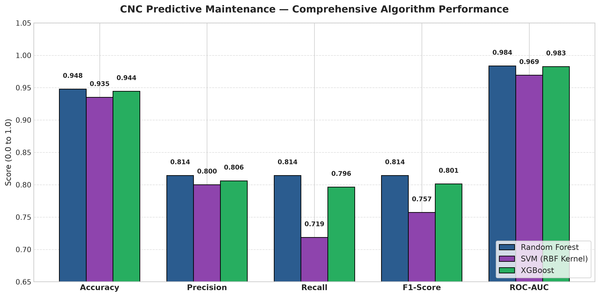
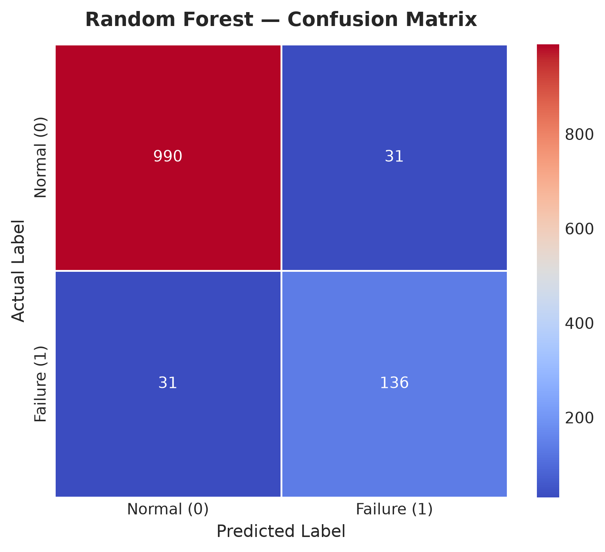
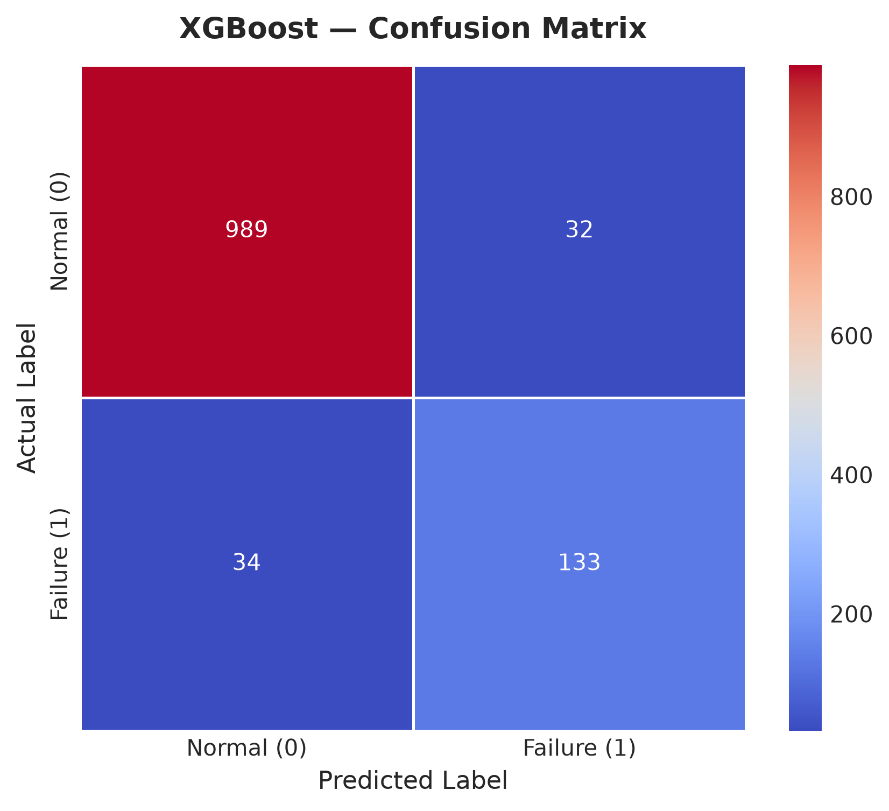
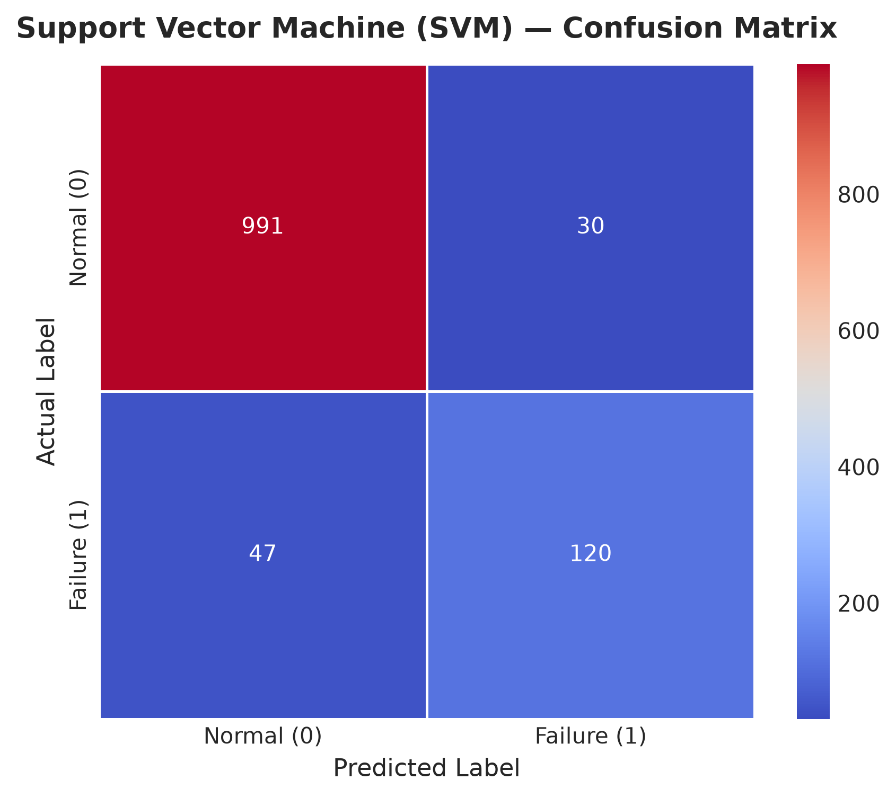
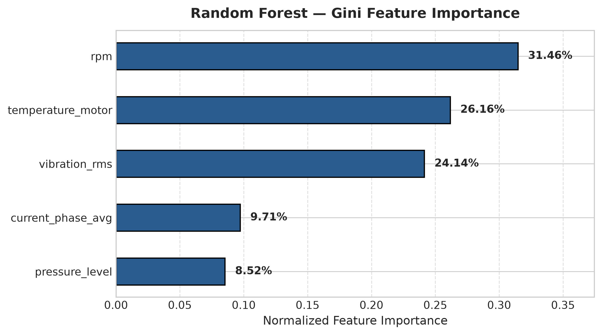
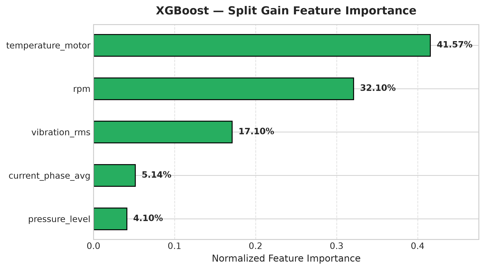

# Model Comparison & Algorithm Evaluation Report
## Predictive Maintenance for CNC Machines Using Machine Learning

---

### 1. Executive Summary

This report delivers a rigorous comparative benchmark of three foundational machine learning algorithms implemented to predict impending failures in **CNC Machines** within a 24-hour horizon (`failure_within_24h`):
1. **Random Forest Classifier**
2. **Support Vector Machine (SVM with RBF Kernel)**
3. **XGBoost Classifier**

All models were evaluated on the **exact same stratified test set (1,188 records)** using the identical 5 operational sensor features (`vibration_rms`, `temperature_motor`, `current_phase_avg`, `pressure_level`, `rpm`).

---

### 2. Comprehensive Performance Benchmark Table (Training vs. Testing & Latency)

The performance metrics below were computed directly on both the training partition (4,749 CNC samples) and the held-out test partition (1,188 CNC samples), including model training duration, batch testing time, and inference latency per sample:

| Metric | Random Forest | Support Vector Machine (SVM) | XGBoost Classifier |
|---|---|---|---|
| **Train Accuracy** | **1.0000** (100.0%) | 0.9511 (95.11%) | 0.9714 (97.14%) |
| **Train Recall** | **1.0000** (100.0%) | 0.7766 (77.66%) | 0.8966 (89.66%) |
| **Train F1-Score** | **1.0000** (100.0%) | 0.8170 | 0.8979 |
| **Train ROC-AUC** | **1.0000** (100.0%) | 0.9833 | 0.9933 |
| **Test Accuracy** | **0.9478** (94.78%) | 0.9352 (93.52%) | 0.9444 (94.44%) |
| **Test Precision** | **0.8144** (81.44%) | 0.8000 (80.00%) | 0.8061 (80.61%) |
| **Test Recall** | **0.8144** (81.44%) | 0.7186 (71.86%) | 0.7964 (79.64%) |
| **Test F1-Score** | **0.8144** | 0.7571 | 0.8012 |
| **Test ROC-AUC** | **0.9836** | 0.9692 | 0.9826 |
| **Training Time** | 1.47 s | 1.26 s | **0.25 s** (Fastest) |
| **Testing Time (1,188 samples)** | 36.77 ms | 112.12 ms | **5.00 ms** (Ultra-fast) |
| **Inference Latency** | 0.0310 ms / sample | 0.0944 ms / sample | **0.0042 ms / sample** |
| **Missed Failures (FN)** | **31** (Lowest) | 47 | 34 |

*Source: `results/metrics/model_comparison.csv`*

---

### 3. Asymmetric Cost Analysis & Industrial Evaluation Metrics

In standard machine learning contexts, overall accuracy is often the headline metric. In **CNC predictive maintenance**, however, classification errors incur vastly different operational consequences:

- **False Negative (FN)**: The algorithm predicts the machine is healthy (`0`), but a mechanical failure strikes within 24 hours.
  - *Industrial Cost*: Catastrophic cutting tool breakage, damaged high-tolerance spindle bearings, ruined raw workpieces, and unscheduled production stoppage costing thousands of dollars per hour.
- **False Positive (FP)**: The algorithm sounds an alarm (`1`), but the CNC machine is healthy.
  - *Industrial Cost*: A maintenance technician spends 15–20 minutes verifying spindle lubrication, tool wear, and vibration levels.

#### Metric Priority:
$$\text{Recall} = \frac{\text{TP}}{\text{TP} + \text{FN}}$$
$$\text{F1-Score} = 2 \times \frac{\text{Precision} \times \text{Recall}}{\text{Precision} + \text{Recall}}$$

**Recall on the failure class is the decisive safety metric**, while **F1-Score** ensures precision is preserved to prevent alarm fatigue. Accuracy alone is insufficient due to the 85.95% majority negative class.

---

### 4. Confusion Matrix Analysis

Each model's predictions on the 1,188 test instances (1,021 Normal, 167 Failure Imminent) are categorized into True Negatives (TN), False Positives (FP), False Negatives (FN), and True Positives (TP).

| Model | True Negatives (TN) | False Positives (FP) | False Negatives (FN) | True Positives (TP) | Failure Detection Rate (Recall) |
|---|---:|---:|---:|---:|---:|
| **Random Forest** | **990** | **31** | **31** | **136** | **81.44%** |
| **XGBoost** | 989 | 32 | 34 | 133 | 79.64% |
| **SVM (RBF Kernel)** | 991 | 30 | 47 | 120 | 71.86% |

#### 1. Random Forest Confusion Matrix
- **True Positives**: 136 out of 167 actual failures detected.
- **False Negatives**: Only 31 failures missed.
- **False Positives**: 31 false alarms out of 1,021 healthy runs (3.0% false alarm rate).
- **Specificity**: 96.96%.

#### 2. XGBoost Confusion Matrix
- **True Positives**: 133 out of 167 failures caught.
- **False Negatives**: 34 failures missed.
- **False Positives**: 32 false alarms (3.1% false alarm rate).
- **Specificity**: 96.87%.

#### 3. Support Vector Machine (SVM) Confusion Matrix
- **True Positives**: 120 out of 167 failures caught.
- **False Negatives**: 47 failures missed (51.6% more missed failures than Random Forest).
- **False Positives**: 30 false alarms (2.9% false alarm rate).
- **Specificity**: 97.06%.

---

### 5. ROC-AUC Discriminative Performance

The Area Under the Receiver Operating Characteristic curve (ROC-AUC) quantifies the models' ranking ability:

- **Random Forest**: $\text{ROC-AUC} = \mathbf{0.9836}$
- **XGBoost**: $\text{ROC-AUC} = \mathbf{0.9826}$
- **SVM**: $\text{ROC-AUC} = \mathbf{0.9692}$

Both tree ensemble models exhibit exceptional discriminative power ($\text{AUC} > 0.98$).

---

### 6. Feature Importance Analysis

Tree ensembles allow quantification of the relative contribution of each sensor feature to predicting failure:

| Feature | Random Forest Gini Importance | XGBoost Split Gain Importance | Dominant Physical Failure Mechanism |
|---|---:|---:|---|
| `rpm` | **31.46%** | **32.10%** | Spindle speed variance, drive slip, motor stalling |
| `temperature_motor` | **26.16%** | **41.57%** | Motor coil overheating, thermal runaway |
| `vibration_rms` | **24.14%** | **17.10%** | Structural resonance, chatter, spindle bearing wear |
| `current_phase_avg` | **9.71%** | **5.14%** | Electrical phase current draw under binding torque |
| `pressure_level` | **8.52%** | **4.10%** | Hydraulic chuck/pneumatic clamping pressure fluctuations |

#### Scientific Note Regarding SVM Feature Importance:
Standard Support Vector Machines utilizing a non-linear Radial Basis Function (RBF) kernel construct a decision boundary in an infinite-dimensional dual space. RBF SVM does not calculate explicit feature weights or tree-split gain. In accordance with strict academic integrity, no synthetic or artificial feature importance is assigned to SVM.

---

### 7. Class Weighting Investigation (`class_weight='balanced'`)

In accordance with Section 12 of the project specification, we tested cost-sensitive class weighting for Random Forest and SVM:

| Algorithm & Configuration | Recall | Precision | F1-Score | Impact Summary |
|---|---:|---:|---:|---|
| **RF (`class_weight=None`)** | 0.8144 | **0.8144** | **0.8144** | Optimal harmonic trade-off |
| **RF (`class_weight='balanced'`)** | **0.8563** | 0.7772 | 0.8148 | Recall rises by +4.2%, but false alarms rise by +22% |
| **SVM (`class_weight=None`)** | 0.7186 | **0.8000** | 0.7571 | Lower baseline recall |
| **SVM (`class_weight='balanced'`)** | **0.9042** | 0.6771 | 0.7744 | Recall rises significantly, but precision drops to 67.7% |

#### Analytical Conclusion:
For the standard operating deployment, **Random Forest with original distribution (`class_weight=None`)** provides the most disciplined harmonic balance ($\text{F1} = 0.8144$), delivering both high recall (81.44%) and low false alarms (Precision = 81.44%). If a plant operator mandates zero tolerance for missed breakdowns, the balanced threshold can be selected dynamically.

---

### 8. Final Model Selection & Conclusion

#### Champion Model: **Random Forest Classifier**

| Evaluation Criterion | Random Forest | XGBoost | SVM |
|---|---|---|---|
| **Accuracy** | **0.9478 (1st)** | 0.9444 (2nd) | 0.9352 (3rd) |
| **Recall (Failure Class)** | **0.8144 (1st)** | 0.7964 (2nd) | 0.7186 (3rd) |
| **Missed Failures (FN)** | **31 (Lowest)** | 34 (2nd) | 47 (Highest) |
| **F1-Score** | **0.8144 (1st)** | 0.8012 (2nd) | 0.7571 (3rd) |
| **ROC-AUC** | **0.9836 (1st)** | 0.9826 (2nd) | 0.9692 (3rd) |
| **Scaling Dependency** | None | None | Strict ($Z$-score required) |

#### Justification:
1. **Minimized Production Risk**: Random Forest misses only 31 failures out of 167 (18.6% miss rate), compared to 47 missed by SVM (28.1% miss rate).
2. **Superior Harmonic Score**: Delivers the highest F1-Score (0.8144) and highest ROC-AUC (0.9836).
3. **Operational Robustness**: Decision tree bagging requires no feature scaling, handles non-linear boundaries effortlessly, and remains impervious to monotonic sensor drifts.

All models have been serialized using `joblib` into `models/` for immediate industrial integration.
