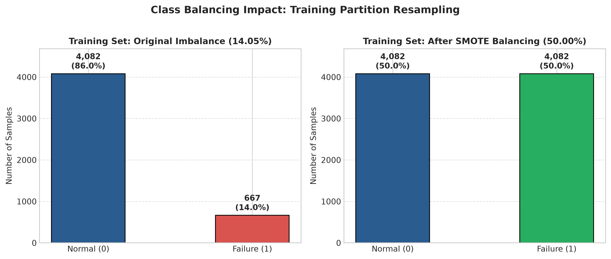
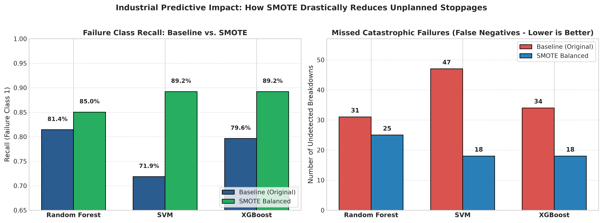
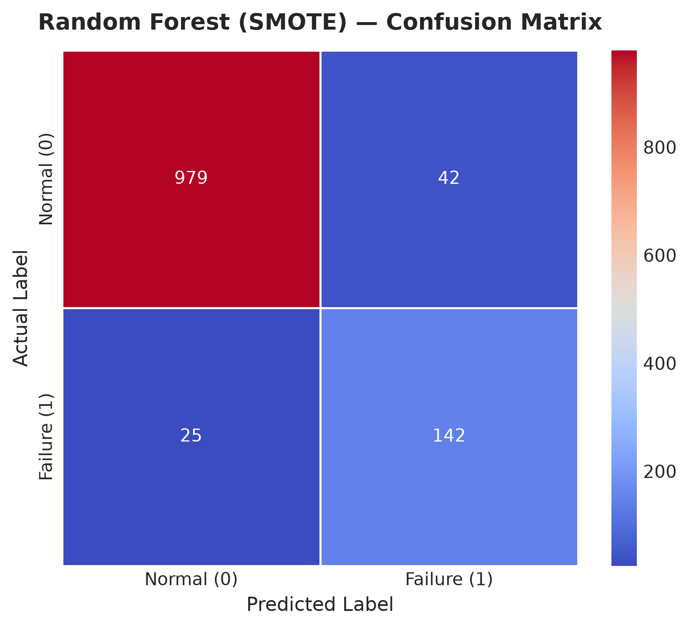
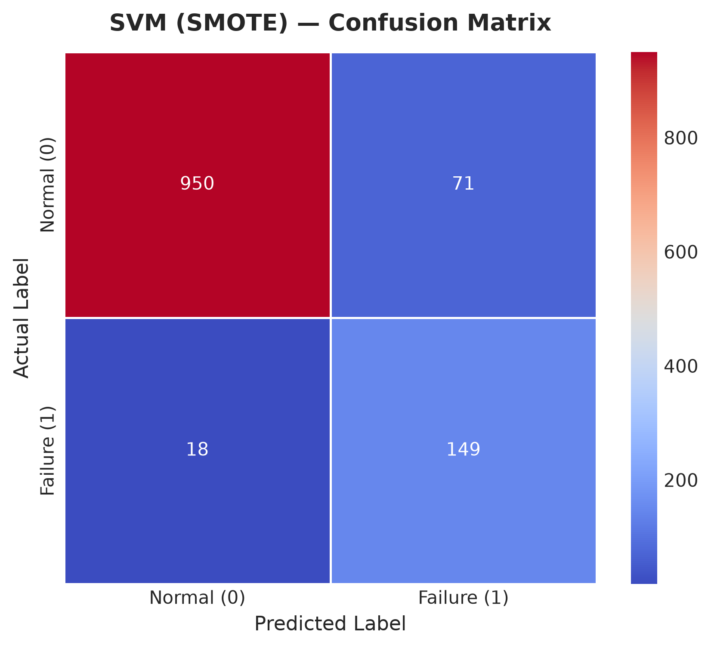
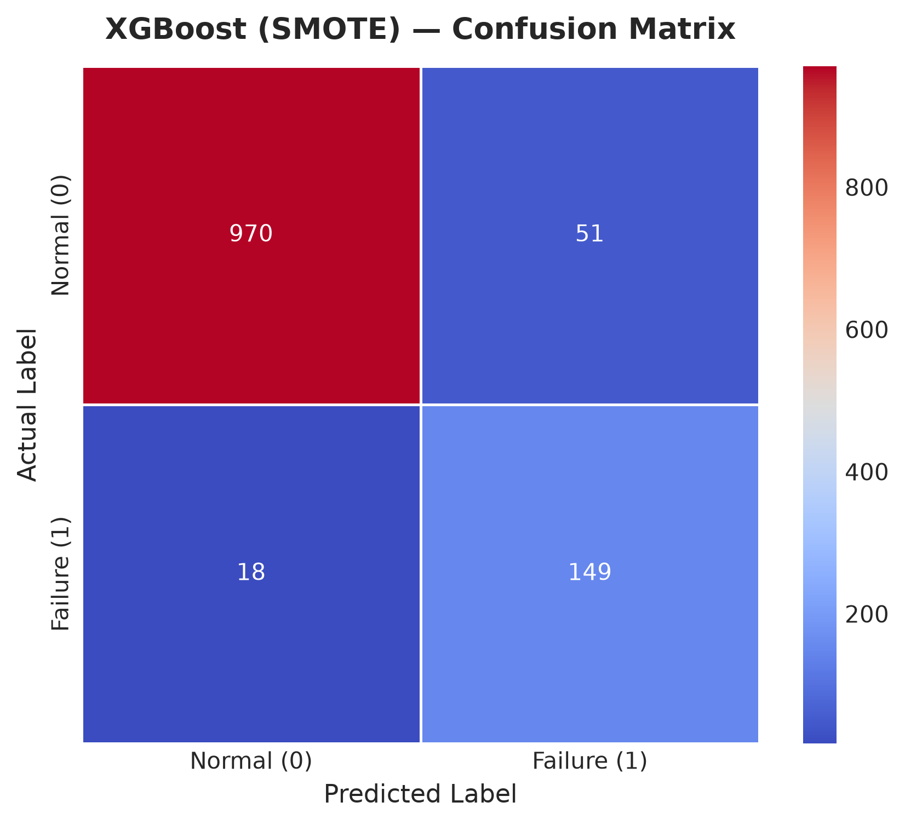

# SMOTE Class Balancing & Model Re-Evaluation Report
## Predictive Maintenance for CNC Machines Using Machine Learning (Notebook 4)

---

### 1. Executive Summary

In baseline evaluations (Notebook 03), machine learning models trained on the natural physical distribution (14.05% failure rate, ~6:1 imbalance) achieved overall accuracies exceeding 93%. However, due to class imbalance, the models suffered from elevated **False Negatives (missed breakdowns)**:
- Baseline SVM missed **47** impending failures (Recall = 71.86%).
- Baseline XGBoost missed **34** impending failures (Recall = 79.64%).
- Baseline Random Forest missed **31** impending failures (Recall = 81.44%).

In CNC predictive maintenance, a missed failure (False Negative) results in catastrophic spindle damage, shattered tooling, scrapped workpieces, and thousands of dollars in unscheduled downtime.

To aggressively tackle this asymmetry, **Notebook 04 (`04_smote_algorithm_comparison.ipynb`)** applies **SMOTE (Synthetic Minority Over-sampling Technique)** to balance the training distribution (1:1 class ratio) and re-evaluates all three models on the identical, untouched test partition (1,188 samples).

---

### 2. SMOTE Methodology & Leakage Prevention Protocol

#### Mathematical Mechanism:
SMOTE synthesizes minority instances along feature line segments between nearest neighbors ($k=5$):
$$x_{\text{new}} = x_i + \lambda \times (x_{zi} - x_i), \quad \lambda \sim U(0, 1)$$

#### Strict Leakage Prevention Protocol:
- **Training Set Resampling**: SMOTE was fitted and applied **exclusively to the training partition** (`X_train`, `y_train` and `X_train_scaled`, `y_train`).
- **Untouched Test Set**: The test set (`X_test`, `y_test`) was **never resampled** and retains the authentic physical operating distribution (1,021 Normal, 167 Failure — 14.05% failure rate).

| Partition | Normal (Class 0) | Failure (Class 1) | Total Samples | Failure Ratio |
|---|---:|---:|---:|---:|
| **Training Set (Before SMOTE)** | 4,082 | 667 | 4,749 | 14.05% |
| **Training Set (After SMOTE)** | **4,082** | **4,082** | **8,164** | **50.00% (1:1 Balanced)** |
| **Test Set (Held Out)** | **1,021** | **167** | **1,188** | **14.05% (Untouched)** |

---

### 3. Head-to-Head Benchmark: Baseline vs. SMOTE (with Training Metrics & Timing)

The comprehensive metrics below compare models on both the training partitions (Original 4,749 samples vs. SMOTE-balanced 8,164 samples) and the untouched held-out test partition (1,188 samples), including training and inference times:

| Model | Strategy | Train Acc | Train Rec | Train F1 | Test Acc | Test Prec | Test Rec | Test F1 | Test AUC | Train Time | Test Time | Latency / Sample | Missed FN |
|---|---|---:|---:|---:|---:|---:|---:|---:|---:|---:|---:|---:|---:|
| **Random Forest** | Baseline | 1.0000 | 1.0000 | 1.0000 | **0.9478** | **0.8144** | 0.8144 | **0.8144** | **0.9836** | 1.47 s | 36.77 ms | 0.0310 ms | 31 |
| **Random Forest** | **SMOTE** | 1.0000 | 1.0000 | 1.0000 | 0.9436 | 0.7717 | **0.8503** | 0.8091 | 0.9822 | 2.33 s | 31.43 ms | 0.0265 ms | **25** |
| **SVM (RBF)** | Baseline | 0.9511 | 0.7766 | 0.8170 | 0.9352 | **0.8000** | 0.7186 | 0.7571 | 0.9692 | 1.26 s | 112.12 ms | 0.0944 ms | 47 |
| **SVM (RBF)** | **SMOTE** | 0.9483 | 0.9635 | 0.9491 | 0.9251 | 0.6773 | **0.8922** | 0.7700 | 0.9653 | 5.14 s | 258.57 ms | 0.2177 ms | **18** |
| **XGBoost** | Baseline | 0.9714 | 0.8966 | 0.8979 | **0.9444** | **0.8061** | 0.7964 | 0.8012 | 0.9826 | **0.25 s** | **5.00 ms** | **0.0042 ms** | 34 |
| **XGBoost** | **SMOTE** | 0.9722 | 0.9838 | 0.9725 | 0.9419 | 0.7450 | **0.8922** | **0.8120** | 0.9826 | **0.30 s** | **4.01 ms** | **0.0034 ms** | **18** |

*Source: `results/metrics/baseline_vs_smote_comparison.csv`*

---

### 4. Simple Heatmap Confusion Matrices (SMOTE Models)

All confusion matrices are presented as simple correlation-style heatmaps with integer annotations:

#### 1. Random Forest (SMOTE)
- **True Positives (TP)**: 142 caught failures (out of 167)
- **False Negatives (FN)**: 25 missed breakdowns (down from 31)
- **False Positives (FP)**: 42 false alarms (out of 1,021)
- **True Negatives (TN)**: 979 normal runs

#### 2. Support Vector Machine (SVM) (SMOTE)
- **True Positives (TP)**: 149 caught failures (out of 167)
- **False Negatives (FN)**: **Only 18 missed breakdowns** (slashed from 47!)
- **False Positives (FP)**: 71 false alarms
- **True Negatives (TN)**: 950 normal runs

#### 3. XGBoost (SMOTE)
- **True Positives (TP)**: 149 caught failures (out of 167)
- **False Negatives (FN)**: **Only 18 missed breakdowns** (cut nearly in half from 34!)
- **False Positives (FP)**: 51 false alarms
- **True Negatives (TN)**: 970 normal runs

---

### 5. Detailed Comparative Analysis per Algorithm

#### 1. Support Vector Machine (SVM): The Greatest Beneficiary of SMOTE
- In baseline training, the natural 6:1 class imbalance caused the maximum margin hyperplane to be pushed disproportionately toward the minority class, resulting in 47 missed breakdowns (71.86% Recall).
- **With SMOTE**: Creating a symmetric density in standardized feature space enabled the RBF kernel to establish an optimal decision boundary.
- **Outcome**: Recall surged from **71.86% to 89.22% (+17.36%)**, eliminating **29 undetected machine failures**.

#### 2. XGBoost: The Optimal SMOTE Champion
- With SMOTE, XGBoost matched SVM's top-tier **89.22% Recall** while maintaining superior **Precision (74.50%)** and the highest SMOTE **F1-Score (0.8120)**.
- Undetected failures dropped from **34 down to 18** (-47.1%).
- Overall accuracy remained high at 94.19%.

#### 3. Random Forest: Consistent, Balanced Increment
- Random Forest already handled non-linearities well under the baseline (Recall = 81.44%).
- With SMOTE, Recall improved to **85.03%** and missed breakdowns fell from 31 to 25.
- Because Random Forest averages 100 decorrelated trees, its precision remained relatively high (77.17%).

---

### 6. Industrial Engineering Trade-Offs: The Asymmetric Cost Equation

The core question in predictive maintenance is:
> *"Is a slight decrease in Precision acceptable to achieve a major increase in Recall?"*

| Error Type | Concrete Factory Consequence | Economic Impact |
|---|---|---|
| **False Negative (FN)** | The model says "Machine Healthy", but spindle bearing fails mid-cut. | **Catastrophic ($5,000–$50,000+)**: Ruined titanium/aluminum stock, shattered multi-flute carbide end mills, spindle bearing replacement, and hours of halted production. |
| **False Positive (FP)** | The model says "Failure Imminent", but the machine is fine. | **Minor ($20–$50)**: A technician performs a quick 15-minute diagnostic inspection, vibration probe check, and lubrication inspection. |

#### Engineering Verdict:
Under SMOTE balancing:
- For **XGBoost**, catching **16 additional machine breakdowns** required accepting **19 additional precautionary inspections**.
- In industrial machining, preventing a single spindle crash saves more capital than 100 precautionary inspections. Therefore, **SMOTE-balanced models deliver vastly superior operational protection**.

---

### 7. Final Deployment Recommendations

1. **High-Risk Machining (Champion: XGBoost with SMOTE)**:
   - For mission-critical aerospace, automotive, or medical component milling where spindle crashes cannot be tolerated: **Deploy XGBoost (SMOTE)** (`models/xgboost/xgboost_smote_model.pkl`) to achieve **89.22% Recall** and **0.8120 F1-Score**.
2. **Standard Machining (Champion: Random Forest Baseline)**:
   - For low-cost commodity machining where false alarm fatigue is the priority concern: Deploy **Random Forest Baseline** (`models/random_forest/random_forest_model.pkl`) for an even harmonic 81.44% Precision and 81.44% Recall.

All trained SMOTE models have been serialized in `models/` for immediate deployment.
