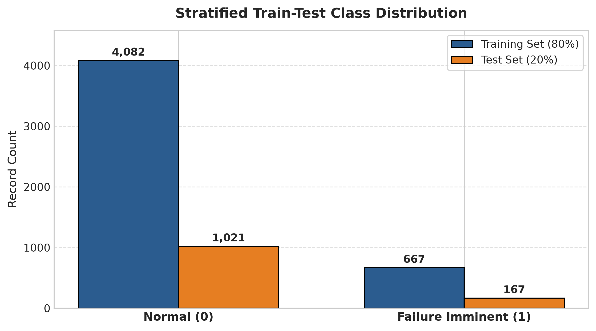
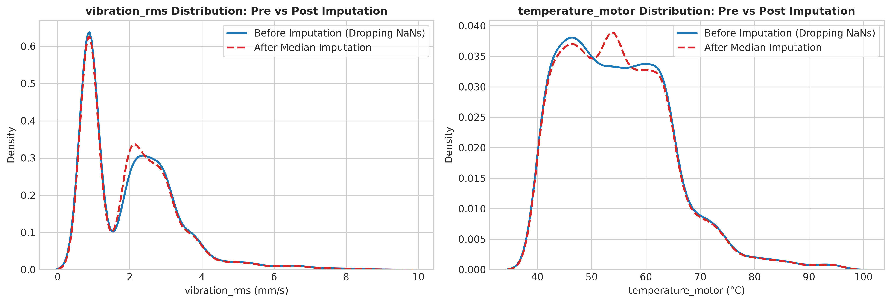
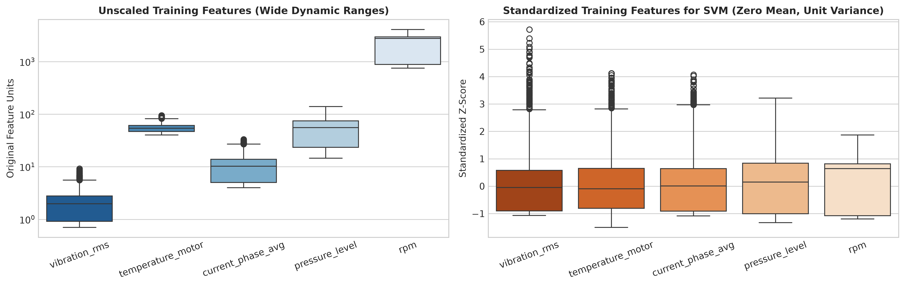

# Data Preprocessing Report
## Predictive Maintenance for CNC Machines Using Machine Learning

---

### 1. Preprocessing Pipeline Architecture

The preprocessing pipeline transforms raw, noisy multi-machine telemetry into clean, leak-free, validated datasets tailored for machine learning model training.

```text
predictive_maintenance_v3.csv (24,042 rows, 15 columns)
                    │
                    ▼
          Filter: machine_type == "CNC"
             (5,937 rows, 15 columns)
                    │
                    ▼
       Extract 6 Columns (5 Features + 1 Target)
             (5,937 rows, 6 columns)
                    │
                    ▼
          Data Integrity Validation
       (0 duplicates, valid binary targets)
                    │
                    ▼
     Stratified Train-Test Split (80% / 20%)
   ┌────────────────────────────────────────┐
   │ Train Set: 4,749 rows (14.05% Failure) │
   │ Test Set : 1,188 rows (14.05% Failure) │
   └────────────────────────────────────────┘
                    │
                    ▼
       Leak-Free Median Imputation
       (Fit on Train -> Transform Train & Test)
                    │
         ┌──────────┴──────────┐
         │                     │
         ▼                     ▼
   Tree-Model Data       StandardScaler
 (RF & XGBoost Input)   (Fit Train -> Transform Test)
                               │
                               ▼
                           SVM Input
```

---

### 2. Feature Extraction & Column Selection

From the filtered CNC records, exactly six columns were retained:

```python
FEATURES = [
    "vibration_rms",
    "temperature_motor",
    "current_phase_avg",
    "pressure_level",
    "rpm"
]

TARGET = "failure_within_24h"
```

All 9 non-operational or metadata columns were permanently removed:
- `machine_type`: Used strictly for filtering.
- `machine_id`, `timestamp`: Identifiers with zero physical generalization capability.
- `product_type`, `operating_mode`: Categorical contextual flags outside the 5 designated sensor features.
- `rul_hours`, `failure_type`, `estimated_repair_cost`: Post-hoc failure details whose inclusion would constitute severe data leakage.

The isolated subset was saved to:
`dataset/processed/cnc_selected_features.csv` (5,937 rows x 6 columns).

---

### 3. Data Validation & Integrity Audit

Prior to mathematical transformations, the dataset was validated against data quality standards:

1. **Dimensional Consistency**: Confirmed exactly 5,937 rows and 6 columns.
2. **Schema & Types**: All 5 input features are continuous floating-point values; target is integer binary.
3. **Duplicate Verification**: Checked full-row duplicates (`0`), feature duplicates (`0`), and feature+target duplicates (`0`). No rows were silently dropped.
4. **Target Integrity**: Verified target domain is strictly $\{0, 1\}$. No negative values, nulls, or ambiguous strings.
5. **No Outlier Trimming**: Confirmed extreme physical values (e.g., motor temperatures reaching 108°C) are retained as valid physical failure indicators.

---

### 4. Stratified Train-Test Partitioning

To evaluate real-world generalization, the dataset was partitioned using an 80/20 stratified split:

```python
X_train, X_test, y_train, y_test = train_test_split(
    X, y, test_size=0.20, random_state=42, stratify=y
)
```

#### Partition Statistics:

| Split Partition | Total Samples | Normal (Class 0) | Failure (Class 1) | Failure Proportion |
|---|---:|---:|---:|---:|
| **Training Set (80%)** | 4,749 | 4,082 | 667 | **14.05%** |
| **Test Set (20%)** | 1,188 | 1,021 | 167 | **14.06%** |
| **Total CNC Fleet** | 5,937 | 5,103 | 834 | **14.05%** |



Stratification guarantees that both training and testing datasets mirror the true industrial operating failure rate.

---

### 5. Missing Value Imputation (Leak-Free Protocol)

Telemetry streams contained missing sensor entries (< 4.1% per feature).

#### Prevention of Data Leakage:
A critical flaw in standard data science pipelines is computing summary statistics over the entire dataset prior to splitting. This introduces subtle data leakage, allowing information from the unseen test set to contaminate training distributions.

To enforce strict leakage prevention:
1. `SimpleImputer(strategy='median')` was fitted **exclusively on `X_train`**.
2. The learned training medians were subsequently applied to transform both `X_train` and `X_test`.

#### Fitted Imputation Medians:

| Sensor Feature | Training Median Learned ($\hat{x}_{train}$) | Train Nulls Resolved | Test Nulls Resolved |
|---|---:|---:|---:|
| `vibration_rms` | **0.840 mm/s** | 192 | 48 |
| `temperature_motor` | **54.80 °C** | 151 | 38 |
| `current_phase_avg` | **12.10 A** | 123 | 31 |
| `pressure_level` | **5.00 bar** | 170 | 42 |
| `rpm` | **902.00 RPM** | 99 | 25 |



Post-imputation verification confirmed **0 missing values** across all partitions with zero alteration of underlying continuous density profiles.

---

### 6. Feature Scaling Protocol (StandardScaler for SVM)

#### Mathematical Necessity for SVM:
Support Vector Machines (SVM) with an RBF kernel calculate Euclidean distances in feature space:
$$K(x, x') = \exp(-\gamma ||x - x'||^2)$$
Without standardization, variables with large absolute magnitudes (`rpm` with values up to 1,650) overwhelm variables with small magnitudes (`vibration_rms` with values ~0.8), rendering distance calculations completely insensitive to vibration.

#### Non-Necessity for Tree Ensembles (Random Forest & XGBoost):
Decision trees perform binary partition splits ($x_j \le \theta$) invariant to monotonic transformations. Scaling neither changes split thresholds nor affects tree structure. Thus, tree algorithms run on original, physically interpretable units.

#### Leakage-Free Standardization:
```python
scaler = StandardScaler()
X_train_scaled = scaler.fit_transform(X_train_imputed)
X_test_scaled = scaler.transform(X_test_imputed)
```

Fitted parameters ($\mu, \sigma$) derived strictly from `X_train`:

| Feature | Learned Mean ($\mu$) | Learned Std ($\sigma$) | Scaled Train $\mu$ | Scaled Train $\sigma$ |
|---|---:|---:|---:|---:|
| `vibration_rms` | 0.9416 | 0.3831 | 0.0000 | 1.0000 |
| `temperature_motor` | 56.4528 | 11.1687 | 0.0000 | 1.0000 |
| `current_phase_avg` | 12.3789 | 2.8488 | 0.0000 | 1.0000 |
| `pressure_level` | 5.1147 | 1.1481 | 0.0000 | 1.0000 |
| `rpm` | 915.0211 | 142.2359 | 0.0000 | 1.0000 |



---

### 7. Class Imbalance Strategy

The CNC dataset exhibits a 14.05% failure proportion (approx. 6:1 imbalance).

#### Why SMOTE / Random Oversampling Was Not Applied:
1. **Physical Sensor Validity**: SMOTE creates synthetic instances via linear interpolation between neighboring feature vectors. In machining telemetry, arbitrary linear combinations can produce physically impossible sensor combinations (e.g., extreme vibration paired with idling current and low temperatures).
2. **False Alarm Inflation**: Synthetic oversampling often causes severe precision degradation, resulting in costly false alarms.
3. **Decision**: Evaluate models on the genuine industrial operating distribution first. Cost-sensitive weighting (`class_weight='balanced'`) is systematically compared at the algorithm level in Notebook 3.

---

### 8. Persisted Preprocessing Artifacts

The following processed files were generated and stored for reproducible model training:

#### Processed Datasets (`dataset/processed/`):
- `cnc_selected_features.csv`: Full CNC dataset with selected 6 columns (5,937 x 6)
- `X_train.csv`: Imputed training features for RF and XGBoost (4,749 x 5)
- `X_test.csv`: Imputed test features for RF and XGBoost (1,188 x 5)
- `X_train_scaled.csv`: Standardized training features for SVM (4,749 x 5)
- `X_test_scaled.csv`: Standardized test features for SVM (1,188 x 5)
- `y_train.csv`: Training labels (4,749 x 1)
- `y_test.csv`: Test labels (1,188 x 1)

#### Serialized Preprocessors (`models/`):
- `imputer.pkl`: Fitted `SimpleImputer` object
- `scaler.pkl`: Fitted `StandardScaler` object
